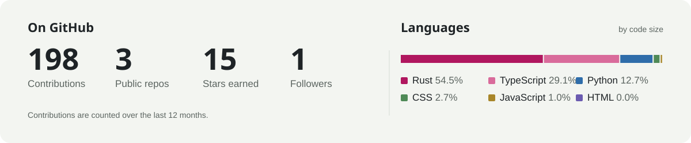

<a href="https://sekaikx.vercel.app">
  <picture>
    <source media="(prefers-color-scheme: dark)" srcset="readme/header-dark.svg">
    
  </picture>
</a>

  
  

Just building things I wish existed. Desktop software, small games, websites, and sometimes taking other people’s software apart to see how it works.

Right now I’m deep in **Lifeline**, a resupply planner for disaster response. It has its own page on my [portfolio](https://sekaikx.vercel.app).

## Stack

**Languages** 
<picture>
  <source media="(prefers-color-scheme: dark)" srcset="https://skillicons.dev/icons?i=rust,ts,js,py,html,css&theme=dark">
  
</picture>

**Frameworks and libraries** 
<picture>
  <source media="(prefers-color-scheme: dark)" srcset="https://skillicons.dev/icons?i=react,tauri,threejs,nodejs,vite,pytorch&theme=dark">
  
</picture>

**Tools** 
<picture>
  <source media="(prefers-color-scheme: dark)" srcset="https://skillicons.dev/icons?i=godot,git,github,vercel&theme=dark">
  
</picture>

## What I make

| Software | Games | Websites | Reverse engineering |
| --- | --- | --- | --- |
| Desktop apps and command-line tools, mostly Rust and TypeScript. If I do a chore twice, I write the program. | Small games in Godot, from quiet places to wander around in to physics toys and strategy prototypes. | Fast, hand-made sites for my projects and for people I know, hosted on Vercel. | Pulling apps, file formats and web APIs apart to see how they really work. |

## Activity

<picture>
  <source media="(prefers-color-scheme: dark)" srcset="readme/stats-dark.svg">
  
</picture>

<picture>
  <source media="(prefers-color-scheme: dark)" srcset="https://raw.githubusercontent.com/sekaikx/sekaikx/output/snake-dark.svg">
  
</picture>

Header and stats are drawn by <a href=".github/profile">.github/profile</a> and refreshed every day by a GitHub Action.
